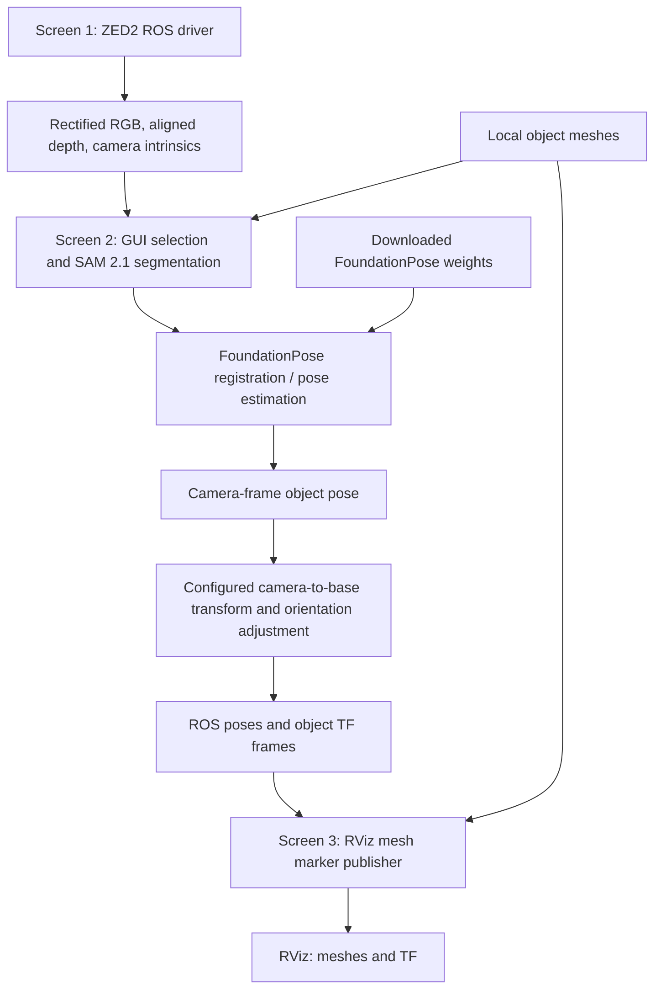

# 6D_POSE_FoundationPose_ROS2

Interactive object pose estimation using **ZED2 RGB-D → SAM 2.1 masks → FoundationPose → ROS TF → RViz meshes**. Includes a RealSense entry point and an optional ArUco calibration helper.

## Installation

Baseline: Ubuntu 22.04, ROS 2 Humble, Python 3.10, an NVIDIA GPU and a compatible CUDA toolkit. The recorded environment uses PyTorch 2.1.0/cu121; CUDA 12.6 below is the original machine's toolkit path. This combination has not been clean-install tested; newer GPUs may require a newer PyTorch/CUDA stack.

1. Install [ROS 2 Humble](https://docs.ros.org/en/humble/Installation/Ubuntu-Install-Debs.html), [Miniconda](https://docs.conda.io/projects/miniconda/en/latest/), the [ZED SDK](https://www.stereolabs.com/developers/release), and a compatible [ZED ROS 2 wrapper](https://github.com/stereolabs/zed-ros2-wrapper). Build/source the wrapper workspace following its release instructions.
2. Clone this project and create the environment:

```bash
git clone https://github.com/mrrahul011/6D_POSE_FoundationPose_ROS2.git
cd 6D_POSE_FoundationPose_ROS2
conda create -n foundationpose_ros python=3.10 -y
conda activate foundationpose_ros
sudo apt install build-essential cmake libeigen3-dev libboost-all-dev python3-tk \
  ros-humble-cv-bridge ros-humble-tf2-ros ros-humble-visualization-msgs ros-humble-rviz2
conda install -y tk
python -m pip install torch==2.1.0 torchvision==0.16.0 torchaudio==2.1.0 --index-url https://download.pytorch.org/whl/cu121
python -m pip install -r requirements.txt
```

3. Download FoundationPose and build its dependencies. See [detailed installation notes](docs/SETUP_REQUIREMENTS.md) for compatibility checks. Use the recorded source revision rather than mixing old code with the latest upstream instructions:

```bash
git clone https://github.com/NVlabs/FoundationPose.git FoundationPose
git -C FoundationPose checkout e3d597b8c6b851d053094ebd6fa240191c5238f8
export CUDA_HOME=/usr/local/cuda-12.6
export PATH="$CUDA_HOME/bin:$PATH"
python -m pip install pybind11==2.10.0 ninja
python -m pip install --no-build-isolation 'git+https://github.com/facebookresearch/pytorch3d.git@75ebeeaea0908c5527e7b1e305fbc7681382db47'
python -m pip install --no-build-isolation 'git+https://github.com/NVlabs/nvdiffrast.git@v0.3.3'
cmake -S FoundationPose/mycpp -B FoundationPose/mycpp/build \
  -Dpybind11_DIR="$(python -m pybind11 --cmakedir)"
cmake --build FoundationPose/mycpp/build -j2
```

These extension commands are a candidate setup, not a validated lockfile. The optional BundleSDF CUDA extension requires C++17 flags in `FoundationPose/bundlesdf/mycuda/setup.py` before installing it with `python -m pip install --no-build-isolation -e FoundationPose/bundlesdf/mycuda`. The legacy root `build_all_conda.sh` is not the recommended installer.

## Download weights and object meshes

- **FoundationPose:** download the complete refiner and scorer folders from the official [network weights link in Data prepare](https://github.com/NVlabs/FoundationPose#data-prepare). Preserve the configuration files alongside `model_best.pth`.
- **SAM 2.1:** download **`sam2.1_b.pt`** from the [Ultralytics model table](https://docs.ultralytics.com/models/sam-2/), and save it in this repository's root. Use the Ultralytics checkpoint, not a differently named raw Meta checkpoint.
- **Objects:** place your OBJ/STL meshes and associated materials/textures under `demo_data/`. Mesh units must be metres and filenames must be unique. Use simple underscore-separated names for compatibility with the RViz helper.

```text
6D_POSE_FoundationPose_ROS2/
├── sam2.1_b.pt
├── FoundationPose/
│   └── weights/
│       ├── 2023-10-28-18-33-37/   # refiner: model_best.pth + config files
│       └── 2024-01-11-20-02-45/   # scorer: model_best.pth + config files
└── demo_data/
    └── my_object/
        └── my_object.obj
```

Weights, datasets, recordings, assets, and Docker files are excluded from Git.

## Run - three screens

### Screen 1 - ZED2 camera

```bash
source /opt/ros/humble/setup.bash
# Also source your ZED wrapper workspace: source <zed_ws>/install/setup.bash
ros2 launch zed_wrapper zed_camera.launch.py camera_model:=zed2
```

### Screens 2 and 3 - activate Conda and ROS

Run this setup in **both** terminals. The last line is the original machine's path; replace it with your clone directory on another machine.

```bash
conda activate foundationpose_ros
source /opt/ros/humble/setup.bash
export LD_PRELOAD=/usr/lib/x86_64-linux-gnu/libstdc++.so.6
export PATH=/usr/local/cuda-12.6/bin${PATH:+:${PATH}}
cd /home/rahul/Desktop/Robin/FoundationPoseROS2
```

**Screen 2 - pose estimation**

```bash
python foundationpose_ros_zed2_v1_5.py
```

Use the GUI to order meshes and follow the image-window prompts for segmentation and pose estimation. A desktop display is required.

**Screen 3 - publish RViz meshes**

```bash
python rviz_marker_v3.py
```

Open `rviz2` from another ROS-sourced terminal (or the desktop). Set **Fixed Frame** to `base_link`, add **TF**, and add a **Marker** display for `/visualization_marker`. RViz must be able to read the local mesh paths.

## Pipeline



**Calibration:** the ZED pose script currently contains a machine-specific camera-to-base matrix and forces a fixed base-frame Z direction. Update these for your setup; the displayed base pose is not the unrestricted camera-frame rotation. `arucomarker_v4.py` is an optional calibration aid with its own hard-coded reference-marker pose. Its result is **not automatically consumed** by the pose script. See [known limitations](docs/INITIAL_ANALYSIS.md) before using these helpers.

**RealSense:** `foundationpose_ros_realsense_v1_1.py` is also included; start a compatible [RealSense ROS driver](https://github.com/realsenseai/realsense-ros) with color-aligned depth instead of the ZED driver. Topic details are in [setup requirements](docs/SETUP_REQUIREMENTS.md).

Built on [FoundationPose](https://github.com/NVlabs/FoundationPose), [FoundationPoseROS2](https://github.com/ammar-n-abbas/FoundationPoseROS2), and [live-pose](https://github.com/Kaivalya192/live-pose). Retain the included license and upstream dependency licenses.
